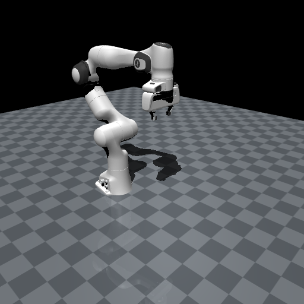

# RoboticsIntro-RUC · MuJoCo

中国人民大学《机器人导论》课程配套实验：**第六周“仿真平台”＋第七周“机械臂抓取实践”**。本分支 `RoboticsIntro-RUC-mujoco` 使用原生 MuJoCo，默认机器人是 Franka Panda；SO100 的本地 URDF、网格和许可证保留用于模型导入实验。



课程入口：[第六周教程](docs/week06.md) · [第七周教程](docs/week07.md) · [第七周 40 页课件文字稿](docs/week07-slides.md) · [迁移计划与教材对照](docs/migration-plan.md) · [验证记录](docs/validation.md)。

## 安装

需要 **64 位 Python 3.11 或 3.12**。建议全班统一 3.11。MuJoCo 的 pip 包自带引擎，无需另外安装 MuJoCo、Vulkan、CUDA、PyTorch 或 ROS。保存图片仍需要 OpenGL 图形上下文。

下载本分支（ZIP 请在 GitHub 切到该分支后下载）：

```text
git clone --branch RoboticsIntro-RUC-mujoco https://github.com/NamelessCrew/RoboticsIntro-RUC.git
cd RoboticsIntro-RUC
```

分支提交推送前，上述远程命令无法取得本地改动；已有课程目录请直接使用当前工作副本。模型随仓库提供，运行实验不下载模型或权重。

**Windows PowerShell 或 cmd**：先安装 [Python 3.11 64 位](https://www.python.org/downloads/)（启用 Python Launcher），打开仓库目录执行：

```powershell
py -3.11 scripts/setup_env.py
py -3.11 run.py doctor
py -3.11 run.py scene
py -3.11 run.py grasp --release-check
py -3.11 run.py vision-grasp
```

也可使用 `setup.cmd`、`run.cmd scene`。PowerShell 使用 `.\setup.cmd`、`.\run.cmd scene`。提供 `.ps1` 便利入口；若系统阻止脚本执行，直接运行上述 `py` 命令即可。

**macOS / Linux**：安装 Python 3.11，然后执行：

```bash
python3.11 scripts/setup_env.py
python3 run.py doctor
python3 run.py scene
python3 run.py grasp --release-check
python3 run.py vision-grasp
```

保留 Bash 入口 `bash setup.sh`、`bash run.sh scene`。安装器创建 `.venv`，运行器自动选择其中的解释器，无需激活环境。若已有旧 ManiSkill `.venv`，先将目录改名备份再安装，避免混用依赖。依赖的完整固定版本见 [requirements.txt](requirements.txt)，各系统共用；安装使用二进制 wheel，避免学生本机编译。

| 系统 | 当前验证范围 |
| --- | --- |
| macOS Apple Silicon | Python 3.11.14、MuJoCo 3.3.7：物理、RGB-D、完整实验与真实接触抓取已执行 |
| Windows x64 | 已提供原生 Python / cmd / PowerShell 入口与 CI 配置；当前机器未实测 |
| Linux x64 | 已提供原生入口与 CI 配置；当前机器未实测 |

交互查看：`python run.py scene --human --seconds 30`。Windows 可把 `python` 替换成 `py -3.11`；macOS 运行器会自动调用 `mjpython`，满足 MuJoCo 查看器的主线程要求。关闭窗口或到时退出。课上主要结果是保存的图像与数据，交互窗口验证单独记在验证记录中。

## 两周实验

以下命令均在仓库根目录执行。Windows 可用 `py -3.11 run.py` 替换 `python run.py`。

| 目标 | 命令 |
| --- | --- |
| 默认 Panda 场景 | `python run.py scene` |
| 本地 SO100 模型 | `python run.py scene --case so100` |
| 执行动作、再重置 | `python run.py reset-step` |
| URDF 关节安装位置 +5 cm | `python run.py urdf` |
| 相机 eye / target | `python run.py scene --case camera`、`--case side_camera` |
| FOV / 分辨率 | `python run.py scene --case fov60`、`--case resolution256` |
| 独立演示相机 | `python run.py scene --case human_camera` |
| 光照 / 初始关节 | `python run.py scene --case lighting`、`--case qpos` |
| 自定义纹理 | `python run.py scene --case texture` |
| 重力与碰撞 | `python run.py cube-drop` |
| 14 组单变量对照 | `python run.py compare` |
| 第六周完整验证 | `python run.py suite` |
| 已知位置抓取基线 | `python run.py grasp --release-check` |
| RGB-D 定位后抓取 | `python run.py vision-grasp` |
| 移动物体后再定位 | `python run.py vision-grasp --cube-x 0.43 --cube-y 0.025` |
| 夹爪张开的失败对照 | `python run.py grasp --keep-open` |
| 物理与数值回归测试 | `python run.py test` |

`--output outputs/my_attempt` 更改输出根目录。第六周命令会在其下创建实验子目录；抓取命令直接写入所指定目录。原有 `official`（ManiSkill 随机动作体验）由可评估的 `grasp` 任务替代；不再运行官方 PickCube 任务。

相机、姿态、灯光预设集中在 [experiments.py](chapters/week06/experiments.py) 的 `CASES`。纹理首次生成于 `.cache/week06/checkerboard.png`，以后保留学生替换的图片。也可指定 `python run.py scene --case texture --texture "C:/class/my floor.png"`；路径含空格请加引号。纹理只影响外观，地面摩擦不变。

## 输出与接口

第六周默认写到 `outputs/week06/`，第七周写到 `outputs/week07/known/` 或 `vision/`：

- `sensor_rgb.png`、`human_render.png`：相互独立的算法相机与演示相机。
- `observations.npz`：`rgb` 与 **`depth_m`（米）**；MuJoCo 深度是沿光轴的 z，不沿射线量距离。本分支不使用旧代码的毫米深度。
- `result.json`：机器人维数、关节与相机参数、物理参数或抓取评价；失败进程返回非零。
- `scene.xml`：运行时 MJCF，网格路径指向本机资源；用于本机调试。跨电脑分享应提交源代码和资源后重新生成。
- 抓取另保存 `calibration.json`、`localization.json`（vision）、`detection.png`、`trajectory.json` / `.npz`、`grasp.gif` 与各阶段 RGB-D。

Panda 有 **9 个 qpos**（7 个臂关节 rad＋2 个手指位移 m）与 **8 路 action**（前 7 项绝对关节角 rad，最后一项 0–255 夹爪开度命令）。SO100 有 6 个 qpos / action（5 个臂关节＋1 个旋转夹爪，均为 rad）。动作不是速度或“每步增加量”。物理 500 Hz、控制 50 Hz，一次 `step` 推进 10 个物理小步，即 0.02 s。

抓取通过两个手指与自由物体的接触和摩擦完成；成功需要抬升至少 6 cm，并在 1 秒保持期持续接触、保持高度与稳定。`--release-check` 打开夹爪后物体会落下。第一阶段使用真值位置，第二阶段仅把定位来源换成 RGB-D 红色掩码；这不是 YOLO，也不声称复现教材的 SO100 香蕉检测任务。模型、检测和控制差异见 [教材对照](docs/migration-plan.md)。

## 故障排查

| 现象 | 处理 |
| --- | --- |
| `py` / `python3.11` 找不到 | 安装 64 位 Python 3.11；Windows 可尝试安装目录内的 `python.exe` |
| Python 版本被拒绝 | 用 3.11 / 3.12 运行安装器；不要用系统 Python 3.14 编译旧 MuJoCo |
| 找不到 `.venv` / 模块 | 回仓库根目录重新运行安装器；保留完整的 assets 目录 |
| `No matching distribution` | 检查 Python 版本、64 位架构、网络和系统 wheel 支持；不要移除版本约束掩盖问题 |
| OpenGL / CGL / GLFW 错误或远程无显示 | 先运行 `doctor` 与 `suite --no-render` / `grasp --no-render` 检查物理；本机桌面再运行图片实验。Linux 无显示服务可按官方文档配置 EGL/OSMesa |
| Windows 只有基础显示驱动 | 安装显卡厂商提供的 OpenGL 驱动后重试 `scene` |
| macOS 提示 `mjpython` | 通过 `run.py ... --human` 启动，不直接从普通 Python 调用查看器 |
| RGB-D 未找到红块 | 检查 `01_initial/sensor_rgb.png` 的可见性、颜色、深度及掩码；该检测器限单个红色平放方块 |
| IK 不可达或跟踪误差过大 | 先恢复默认物体位置，查看轨迹；线性规划器不避障，不支持任意工作空间目标 |

`--no-render` 跳过图像，报告会标明 `rendered=false`，不能据此判断视觉功能通过。`vision-grasp --no-render` 会明确报错。测试不需要图形设备；视觉抓取和课程图片需要。

官方参考：[MuJoCo Python 安装与查看器](https://mujoco.readthedocs.io/en/3.3.7/python.html)、[模型与 URDF 导入](https://mujoco.readthedocs.io/en/3.3.7/modeling.html)、[MJCF 参数](https://mujoco.readthedocs.io/en/3.3.7/XMLreference.html)。资源来源和许可证见 [NOTICE](NOTICE.md)。
