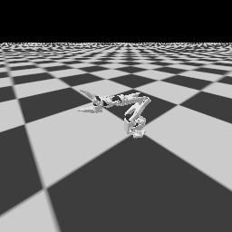

# RoboticsIntro-RUC

中国人民大学《机器人导论》课程配套代码。第一版对应第六周“仿真平台”：从运行 SO100 场景开始，学习 URDF、相机、地面、光照、初始化、`reset / step`，再用对照实验检查结果。

课程仓库：<https://github.com/NamelessCrew/RoboticsIntro-RUC>



## 从哪里开始

1. 按下文完成一次安装。
2. 运行 `bash run.sh scene`，确认生成场景图像。
3. 按 [第六周实验教程](docs/week06.md) 逐项练习。
4. 运行 `bash run.sh suite` 检查整章实验，查看 [验证范围与记录](docs/validation.md)。

所有命令均在 **RoboticsIntro-RUC 仓库根目录**执行，使用 Bash。无需手动激活虚拟环境，`run.sh` 会使用本仓库的 `.venv/bin/python`。

## 1. 运行条件

| 平台 | 第一版支持范围 | 需要准备 |
| --- | --- | --- |
| macOS Apple Silicon | 已在 Apple M2 上验证 | Python 3.10、uv、Vulkan SDK / MoltenVK |
| Linux | 提供安装路径，当前发布未实机验证 | Python 3.10、uv、可用的 Vulkan 显卡驱动 |
| Windows / WSL | 当前版本未验证 | 建议使用课程提供的 Linux 机器，不把 WSL 等同于已验证环境 |

本课固定为 **单环境、CPU 物理仿真**。图像仍需要可用的 Vulkan 渲染设备；不加 `--human` 只是不开交互窗口，仍会渲染图片。macOS 的 GPU 物理仿真不在本课范围内，平台说明见 [ManiSkill macOS 安装文档](https://maniskill.readthedocs.io/en/latest/user_guide/getting_started/macos_install.html)。

已验证的核心版本：Python 3.10.19、ManiSkill 3.0.1、SAPIEN 3.0.3、Gymnasium 1.4.0、PyTorch 2.14.1、NumPy 2.2.6。macOS 完整版本固定在 [requirements-macos.lock.txt](requirements-macos.lock.txt)，请先使用课程版本完成实验。

## 2. 下载仓库

有 Git 时：

```bash
git clone https://github.com/NamelessCrew/RoboticsIntro-RUC.git
cd RoboticsIntro-RUC
```

没有 Git 时，可在 GitHub 点击 **Code → Download ZIP**，解压并进入 `RoboticsIntro-RUC-main`。两种方式都要保留完整目录，不能只复制 Python 文件。SO100 的 URDF 与 mesh 已随仓库提供。

```bash
pwd
ls
# 应看到 README.md、setup.sh、run.sh、chapters、scripts
```

## 3. 安装 uv

macOS 已有 Homebrew 时：

```bash
brew install uv
uv --version
```

macOS / Linux 也可使用 uv 官方安装器：

```bash
curl -LsSf https://astral.sh/uv/install.sh -o /tmp/uv-install.sh
sh /tmp/uv-install.sh
```

按安装器提示重新打开终端，再执行 `uv --version`。其他安装方式见 [uv 官方安装说明](https://docs.astral.sh/uv/getting-started/installation/)。`setup.sh` 会让 uv 创建 Python 3.10 环境，缺少对应解释器时由 uv 下载。

## 4. 准备 Vulkan

### macOS

1. 按 [ManiSkill macOS 文档](https://maniskill.readthedocs.io/en/latest/user_guide/getting_started/macos_install.html) 安装 Vulkan SDK。课程验证使用 **1.3.290.0**，文档提供了对应的官方安装包链接。
2. 记下安装位置，例如 `~/VulkanSDK/1.3.290.0/macOS`。
3. 在运行实验的终端中设置：

```bash
export VULKAN_SDK="$HOME/VulkanSDK/1.3.290.0/macOS"
test -f "$VULKAN_SDK/share/vulkan/icd.d/MoltenVK_icd.json" && echo "SDK 路径正确"
```

如安装在其他位置，请替换路径。`run.sh` 会配置 SDK 的 `PATH`、驱动 JSON 和动态库路径；也接受 SDK 根目录，并自动定位其 `macOS` 子目录。若希望新终端自动生效，可自行将上面的 `export VULKAN_SDK=...` 加到 `~/.zshrc`。不要把示例里的用户名或路径照搬成他人的本地路径。

### Linux

先按显卡厂商说明安装驱动，并确认 Vulkan 可用。`vulkaninfo --summary` 可用于检查驱动；该命令通常由系统的 Vulkan 工具包提供。Linux 上不要设置 macOS 的 MoltenVK 变量。参考 [ManiSkill 安装说明](https://maniskill.readthedocs.io/en/latest/user_guide/getting_started/installation.html)。本仓库 Linux 依赖入口为 `requirements.txt`，安装后仍需完成下面的场景验证。

## 5. 安装课程依赖

```bash
bash setup.sh
```

脚本会创建 `.venv`、安装依赖、检查包版本兼容性，并导入仿真库检查本地模型文件。首次安装需要联网下载较大的 PyTorch、ManiSkill 等包，请等待完成。重复运行会复用已有环境；脚本不会修改系统 Python。

成功时能看到 `All installed packages are compatible` 和“导入与文件检查通过”。这一步还不能证明渲染可用。

单独重新检查：

```bash
bash run.sh doctor
```

## 6. 先运行默认场景

```bash
# 保存图片，不打开交互窗口
bash run.sh scene

# 在桌面打开窗口，显示 120 秒；也可以提前关闭窗口
bash run.sh scene --human --seconds 120
```

预期看到白色 SO100 机械臂和灰色网格地面。默认场景保持静止，用于检查装配；运动实验见下一节。

输出在 `outputs/week06/scene/baseline/`：

| 文件 | 用途 |
| --- | --- |
| `sensor_rgb.png` | 算法相机的 128×128 RGB 输入 |
| `human_render.png` | 独立演示相机的 512×512 画面 |
| `observations.npz` | RGB 与毫米单位的深度数组 |
| `result.json` | qpos、动作维数、相机参数、世界坐标等 |

`--output` 指定输出根目录，避免覆盖上次结果：

```bash
bash run.sh scene --case camera --output outputs/camera_try1
# 图像在 outputs/camera_try1/scene/camera/
```

## 7. 按课件做实验

| 任务 | 命令 | 观察重点 |
| --- | --- | --- |
| 执行动作再重置 | `bash run.sh reset-step` | 第一个关节到约 0.3 rad，再回到 0 |
| URDF 安装位置 +5 cm | `bash run.sh urdf` | 底座不动，下游连杆上移 0.05 m |
| 只移动相机 eye | `bash run.sh scene --case camera` | 图像变，机器人世界状态不变 |
| 同时调整 eye / target | `bash run.sh scene --case side_camera` | 与课件侧面视角对应 |
| 替换地面纹理 | `bash run.sh scene --case texture` | 外观改变，摩擦保持原值 |
| 90° 改为 60° 视场角 | `bash run.sh scene --case fov60` | 相机不动，视野变窄 |
| 128² 改为 256² 分辨率 | `bash run.sh scene --case resolution256` | 视野相同，像素数 ×4 |
| 改演示相机 | `bash run.sh scene --case human_camera` | `human_render.png` 变，`sensor_rgb.png` 不变 |
| 改初始关节位置 | `bash run.sh scene --case qpos` | 检查机械臂和夹爪姿态 |
| 降低环境光 | `bash run.sh scene --case lighting` | 只改整体亮度，保留方向光 |
| 替换为 Panda | `bash run.sh scene --case panda` | qpos 为 9，action 为 8 |
| 方块下落 | `bash run.sh cube-drop` | 有碰撞停在 z≈0.02 m，无碰撞穿地 |
| 逐项对照 | `bash run.sh compare` | 保存 15 组场景并检查不变量 |
| 全章验证 | `bash run.sh suite` | 六组实验全部通过 |

详细步骤、源代码位置、59 页课件对照见 [docs/week06.md](docs/week06.md)。

## 8. 修改代码与纹理

参数预设集中在 [`chapters/week06/experiments.py`](chapters/week06/experiments.py) 的 `CASES`。场景实现位于 [`chapters/week06/scene.py`](chapters/week06/scene.py)：

| 方法或常量 | 修改内容 |
| --- | --- |
| `QPOS_PRESETS`、`_initialize_episode` | 初始关节位置与重置 |
| `_default_sensor_configs` | 算法相机位置、FOV、分辨率 |
| `_default_human_render_camera_configs` | 演示相机 |
| `_load_scene` | 地面、纹理与方块碰撞 |
| `_load_lighting` | 环境光与方向光 |

重要实现有中文注释。改动构造参数后要重新创建环境；只调用 `reset` 不会自动重新加载所有模型或相机配置。

第一次运行 `--case texture` 会生成 `.cache/week06/checkerboard.png`。可以编辑或替换该文件，再运行相同命令，程序会保留你的图片。也可以直接指定自己的 PNG：

```bash
bash run.sh scene --case texture --texture /完整路径/my_floor.png --output outputs/my_floor
```

普通 SO100 场景使用 ManiSkill 内置模型。`urdf` 实验通过 [`robot.py`](chapters/week06/robot.py) 使用仓库内的可编辑模型，将修改后的副本写入输出目录，保留原始 URDF。修改仓库 URDF 后，需选用 `robot_uids="so100_custom"` 才会加载该文件；完整做法见实验教程。

## 9. 常见问题

| 现象 | 处理方法 |
| --- | --- |
| `uv: command not found` | 按安装器提示更新 PATH，重新打开终端后检查 `uv --version` |
| 找不到 `.venv` 或模块 | 回到仓库根目录运行 `bash setup.sh`，用 `bash run.sh` 启动 |
| 已有 Python 版本不是 3.10 | 将旧 `.venv` 改名备份，再运行 `bash setup.sh` |
| `Vulkan SDK` 找不到 | 检查 `VULKAN_SDK` 和 `MoltenVK_icd.json` 是否存在 |
| `ErrorIncompatibleDriver` / 无 Vulkan 设备 | 检查显卡驱动与 SDK，确认进程可访问显卡；受限沙箱或远程终端可能无法访问本机图形设备 |
| 导入成功，但没有窗口 | 先运行无窗口的 `scene` 检查图片，再检查桌面会话和 `--human` 参数 |
| 提示未安装 `pinocchio` | 本章使用关节 PD 控制，不需要该可选逆运动学组件；以场景和 suite 结果判断是否通过 |
| 修改相机后演示画面不变 | 检查 `sensor_rgb.png`；算法相机与演示相机分开配置 |
| 修改 `assets/so100/so100.urdf` 后默认场景不变 | 默认用内置 `so100`；URDF 实验用 `so100_custom` |
| 图像被上次运行覆盖 | 用不同 `--output` 目录保存每次实验 |
| 下载超时或模型缺失 | 检查网络后重试，不跳过依赖；`doctor` 会检查仓库内的网格文件 |

## 目录

```text
RoboticsIntro-RUC/
├── README.md                    # 安装与开始使用
├── setup.sh                     # 创建环境和安装依赖
├── run.sh                       # 统一运行入口
├── requirements-macos.lock.txt  # macOS 完整锁定版本
├── requirements.txt             # Linux 核心依赖
├── chapters/week06/
│   ├── experiments.py           # CASES 与各实验
│   ├── hello_robot.py           # 最小场景入口
│   ├── scene.py                 # SO100 场景
│   ├── panda.py                 # Panda 初始化与相机
│   ├── robot.py                 # 本地 URDF 注册
│   └── assets/so100/            # URDF、mesh、模型许可证
├── scripts/doctor.py            # 环境与资源检查
├── tests/                      # 纹理覆盖行为回归检查
└── docs/                       # 逐页对照、验证记录与真实截图
```

运行生成的 `outputs/`、依赖、缓存和下载资源不提交到 Git。来源与第三方材料说明见 [NOTICE.md](NOTICE.md)。
