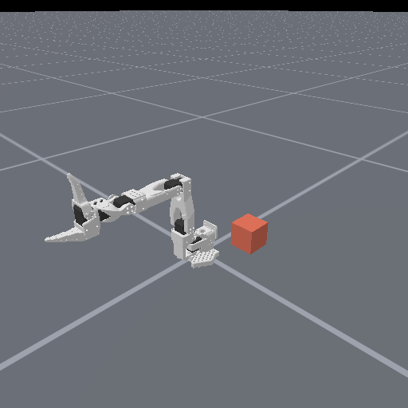

# 第六周：仿真平台实验教程

对应 **59 页“课程仓库版”课件**。后续课件若增删页面，请优先按标题和函数名定位。本教程所有命令均在仓库根目录执行，安装步骤见 [README](../README.md)。

## 建议上课顺序

先运行 `bash run.sh scene --human` 检查机械臂和地面，再依次完成下面的实验。每次修改前保留原始图片、写下预测，然后只改变一个参数。

## 实验 1：reset 与 step（第 41–42 页）

```bash
bash run.sh reset-step
```

源代码：`chapters/week06/experiments.py` 的 `reset_step`。

1. `create_env` 创建环境，控制模式是 `pd_joint_pos`。
2. `reset(seed=0)` 初始化机器人，记录 `qpos`。
3. 将第一个关节的绝对目标增加 0.3 rad，执行 40 次 `step`。
4. 再次 `reset`，检查机器人是否回到初始位置。

结果目录为 `outputs/week06/reset_step/`，依次比较 `01_reset`、`02_step`、`03_reset_again`。控制频率 20 Hz，物理频率 100 Hz，一次 `step` 包含 5 个物理小步，40 次动作对应 2 秒仿真时间。

注意：`action` 的含义由控制器决定。这里传入目标关节位置，不是每步转动 0.3 rad，也不是速度。

## 实验 2：URDF 安装位置（第 27–37 页）

```bash
bash run.sh urdf
```

源代码：`experiments.py` 的 `urdf_experiment`，机器人注册在 `robot.py`。

模型文件：`chapters/week06/assets/so100/so100.urdf`。

找到 `shoulder_pan` 的 `origin`：

```xml
<!-- 修改前，单位为米 -->
<origin xyz="0 -0.0452 0.0165" rpy="1.5708 0 0"/>
<!-- 实验副本中只把 z 增加 0.05 -->
<origin xyz="0 -0.0452 0.0665" rpy="1.5708 0 0"/>
```

脚本在 `outputs/week06/urdf/` 创建 `before.urdf` 与 `after.urdf`，分别加载并保存图像。检查 `result.json`：底座位置不变，下游连杆世界坐标的 z 增加 0.05 m，原始文件摘要保持不变。网格外观不会自动变长，因此出现装配间隙正是这个修改的可观察结果。

如果要手动编辑本地模型并看默认场景，可在 `CASES` 中加入：

```python
"my_urdf": {"robot_uids": "so100_custom"},
```

然后运行 `bash run.sh scene --case my_urdf`。内置 `so100` 和本地 `so100_custom` 是两个注册名，不能混淆。

第 30–33 页的 `joint1` XML 是标签讲解示例，不是 SO100 的实际关节参数。第 36 页使用本模型的真实值。

## 实验 3：地面纹理（第 43 页）

```bash
bash run.sh scene --case baseline --output outputs/floor_before
bash run.sh scene --case texture --output outputs/floor_checker
```

打开 `.cache/week06/checkerboard.png`，替换为自己的图片，再运行：

```bash
bash run.sh scene --case texture --output outputs/floor_custom
```

函数 `_checkerboard_texture` 仅在图片不存在时生成棋盘格，之后不会覆盖学生的图片。也支持 `--texture /完整路径/图片.png`。比较三个目录中的 `scene/预设名/sensor_rgb.png` 和 `result.json`：图像改变，但地面 `ground_materials` 的摩擦参数应相同。

要恢复默认棋盘格，可将自定义 PNG 改名备份，下一次运行会重新生成。

## 实验 4：相机（第 44–48 页）

```bash
bash run.sh scene --case baseline
bash run.sh scene --case camera
bash run.sh scene --case side_camera
bash run.sh scene --case fov60
bash run.sh scene --case resolution256
bash run.sh scene --case human_camera
```

源代码：`experiments.py` 的 `CASES`，以及 `scene.py` 的 `_default_sensor_configs`。

| 预设 | 参数 | 预期结果 |
| --- | --- | --- |
| `baseline` | eye=[0.5,-0.5,0.5]，target=[0,0,0.15] | 默认算法相机 |
| `camera` | 只把 eye 改为 [0,-0.8,0.4] | 单变量实验 |
| `side_camera` | eye=[0,-0.8,0.4]，target=[0,0,0] | 对应第 45 页侧面视角 |
| `fov60` | FOV=π/3，其他不变 | 视野变窄，焦距约为原来的 √3 倍 |
| `resolution256` | 256×256，其他不变 | 像素数 ×4，视野不变 |
| `human_camera` | 只改演示相机 | 演示图改变，算法输入逐像素相同 |

不要把交互窗口的视角当作算法输入。算法相机来自 `obs["sensor_data"]`，保存为 `sensor_rgb.png`；演示相机保存为 `human_render.png`。交互查看器还有自己的 `viewer_camera_configs`。

## 实验 5：姿态、灯光与机器人替换（第 49–52 页）

```bash
bash run.sh scene --case qpos
bash run.sh scene --case lighting
bash run.sh scene --case panda
```

- `scene.py` 的 `QPOS_PRESETS`：SO100 的前 5 个数为机械臂关节，第 6 个是夹爪关节，均为弧度。`0.6` 不是“张开 60%”。
- `_load_lighting`：将环境光从 `[0.3,0.3,0.3]` 改为 `[0.08,0.08,0.12]`，保留方向光和物理设置。
- `panda.py`：Panda 使用 7 个臂关节和 2 个手指关节，因此 qpos 长度为 9；控制器用一个命令协调两个手指，所以动作长度为 8。

## 实验 6：重力与碰撞（第 5–6、55–56 页）

```bash
bash run.sh cube-drop
```

源代码：`scene.py` 的 `_load_scene` 创建方块，`experiments.py` 的 `cube_drop` 执行和验证。

方块边长 0.04 m，中心初始高度 0.30 m，地面 z=0，重力指向 −z。开启碰撞时，平放后中心应约为 0.02 m；关闭碰撞时，外观仍可见，但方块会穿过地面。输出包含 `drop.gif`、`height_trace.npz` 与 JSON 结果。重新 `reset` 后还要检查位置和速度已恢复。



## 课堂练习（第 58 页）

```bash
bash run.sh scene --case exercise_baseline
bash run.sh scene --case exercise_texture
bash run.sh scene --case exercise_camera
bash run.sh scene --case exercise_final
```

四个预设固定为 256×256，逐步加入棋盘格、斜上方相机和新 qpos。最终相机 eye=[0.32,-0.44,0.44]，target=[0,-0.17,0.17]，姿态使用 `raised`。

提交前后两张算法相机图、修改的参数或代码片段，以及每项改变的解释。检查底座、夹爪与地面都在画面中。示例可用于核对，不替代自己修改与解释。

## 全章验证

```bash
bash run.sh compare
bash run.sh suite
```

`compare` 检查 15 个场景；`suite` 还检查匀速算例、官方 PickCube 任务、URDF、reset/step 与碰撞。成功时 `outputs/week06/suite.json` 的 `status` 为 `passed`；失败时进程返回非零并写入失败实验名。官方任务只运行 30 次随机动作，验证运行和渲染，不代表已学会抓取。

## 课件页码索引

| 页码 | 标题或内容 | 对应入口或阅读位置 |
| --- | --- | --- |
| 1–4 | 课程目标、目录、平台介绍 | 本教程的建议顺序 |
| 5–6 | 红色方块与碰撞 | `bash run.sh cube-drop` |
| 7–8 | 试错与重复实验 | `reset-step`、`reset_step` |
| 9 | 时间小步 | `bash run.sh time`，匀速算例 |
| 10–12 | 组成、交互、状态与图像 | `create_env`、`snapshot`、`cube_drop` |
| 13–21 | 平台比较与 ManiSkill | 概念介绍；`bash run.sh official` 可体验 PickCube |
| 22–24 | 下载、安装、默认场景 | 根目录 README、`setup.sh`、`run.sh` |
| 25–26 | 框架与 URDF 章节 | `scene.py`、`robot.py` |
| 27–34 | URDF 标签与物理意义 | `assets/so100/so100.urdf`；示例 XML 与真实模型区分 |
| 35–37 | URDF 导入与检查 | `robot.py`、`urdf_experiment`、`bash run.sh urdf` |
| 38–40 | 目录与环境方法 | `chapters/week06/`、`scene.py` |
| 41–42 | 创建、重置、执行动作 | `reset_step`、`bash run.sh reset-step` |
| 43 | 地面 PNG | `_load_scene`、`_checkerboard_texture` |
| 44–45 | eye / target | `CASES["side_camera"]`、`_default_sensor_configs` |
| 46–47 | FOV 与分辨率 | `CASES["fov60"]`、`CASES["resolution256"]` |
| 48 | 演示相机与算法输入 | `CASES["human_camera"]`、`snapshot` |
| 49–50 | qpos 与灯光 | `QPOS_PRESETS`、`_initialize_episode`、`_load_lighting` |
| 51–52 | Panda 与动作维数 | `panda.py`、`snapshot` |
| 53–54 | 单变量对照 | `compare` 与 `CASES` |
| 55–56 | 方块的创建与运行 | `_load_scene`、`cube_drop` |
| 57 | 域随机化 | 概念介绍；本章预设为固定对照，未执行随机训练 |
| 58–59 | 练习与结束 | `exercise_*` 预设 |
