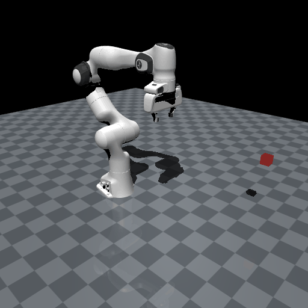

# 第六周：仿真平台（MuJoCo 版）

本课从“场景能运行”走向“能解释实验结果”：模型、状态、控制、相机、外观与物理分别承担什么角色。命令使用 `python run.py`；Windows 可写 `py -3.11 run.py`。先按根目录 README 安装。

## 教学顺序

先展示 `scene`，识别 Panda、地面、算法相机和演示相机。每次先预测结果，再只改一个参数，最后用图像与 JSON 同时检查。不把“画面变了”直接解释为“物体动了”。

本分支默认 Panda；保留 SO100 作为 URDF 导入对象。不要照搬旧课件的六维默认 qpos 或 `pd_joint_pos` / ManiSkill 注册接口。

## 1. 时间小步与 reset / step

```text
python run.py time
python run.py reset-step
```

`scene.py` 的 `RobotEnv` 直接持有 `mujoco.MjModel`（结构与参数）和 `mujoco.MjData`（动态状态）。`reset` 调用 `mj_resetData`，恢复关节位置、自由物体位置、速度、时间与控制目标，然后 `mj_forward` 更新世界坐标。`step` 将绝对关节目标写入 `data.ctrl`，调用 `mj_step(..., nstep=10)`。

物理频率 500 Hz，控制频率 50 Hz；100 次动作对应 2 s 仿真时间。PD 执行器通过力矩使关节追踪目标，写 `ctrl` 不等于瞬间修改 `qpos`。

`reset-step` 把第一个关节目标设为 0.3 rad，执行 100 次，验证误差小于 0.01 rad，再重置并验证初始 qpos、零速度与零时间。输出 `01_reset`、`02_step`、`03_reset_again`。思考：把动作写成 0.3，为什么不等于每步再转 0.3？

## 2. URDF 导入与安装位置 +5 cm

```text
python run.py scene --case so100
python run.py urdf
```

SO100 源文件是 `chapters/week06/assets/so100/so100.urdf`。`robot.py` 用 MuJoCo 的原生 URDF 编译器导入，再添加课程位置执行器、地面、相机和灯光。MuJoCo 接受 STL/OBJ 网格；原始 PLY 夹爪碰撞网格在 `.cache/so100/` 转为 OBJ，保留原件与各子网格的凸分解。URDF 不是完整仿真任务，导入后还需明确控制器与环境设置。

`urdf` 创建 `before.urdf` 和 `after.urdf`，只改 SO100 的 `shoulder_pan`：

```xml
<origin xyz="0 -0.0452 0.0165" rpy="1.5708 0 0"/>
<!-- 实验副本 -->
<origin xyz="0 -0.0452 0.0665" rpy="1.5708 0 0"/>
```

结果：Base 不变，其下全部连杆的世界 z 坐标增加 0.05 m。网格不会变长，所以连接处可出现缝隙。JSON 验证下游位移和原文件 SHA256；源 URDF 不被覆盖。输出副本引用的是课程原始 mesh，不能脱离仓库单独分享。

Panda 使用 Menagerie 已整理的 MJCF。对比两条模型路径：URDF 描述机器人结构；MJCF 能直接表达执行器、接触、传感器和场景。实际物理效果还取决于凸碰撞代理、惯量和求解器设置，导入成功不等于现实参数已校准。

## 3. 地面与学生纹理

```text
python run.py scene --case baseline
python run.py scene --case texture
python run.py scene --case texture --texture "C:/class/my_floor.png" --output outputs/my_floor
```

第一次运行生成 `.cache/week06/checkerboard.png`，后续保持现有字节。学生可替换为 PNG；若要恢复棋盘格，先备份或移走自定义文件。`RobotEnv._checkerboard_texture` 负责只生成一次。

比较外观和 `ground_friction`：纹理改变不改变摩擦。MuJoCo 摩擦参数依次为滑动、扭转、滚动系数；本实验保持地面 `[1, 0.005, 0.0001]`。不要把图片的粗糙感当作碰撞参数。

## 4. 相机的 eye、target、FOV 与分辨率

```text
python run.py scene --case camera
python run.py scene --case side_camera
python run.py scene --case fov60
python run.py scene --case resolution256
python run.py scene --case human_camera
```

Panda 默认算法相机 eye=[1,-1,0.8]，target=[0.25,0,0.3]，128×128、垂直 FOV=90°。`camera` 仅移动 eye 到 [0,-1.2,0.7]；`side_camera` 再把 target 改为 [0.2,0,0.2]。配置经 `camera_xyaxes` 转成 MuJoCo 相机局部 +X/+Y 轴，相机沿局部 −Z 看向目标。

| 改动 | 预测与验证 |
| --- | --- |
| FOV 90°→60° | 视野变窄，`f = height / (2 tan(FOV/2))`，焦距变为 √3 倍 |
| 128²→256² | FOV 相同，像素数 ×4，焦距像素值 ×2 |
| 仅改变算法相机 | 机器人 qpos 与世界坐标相同，演示相机参数独立 |
| 仅改变演示相机 | `sensor_rgb.png` 逐像素相同，`human_render.png` 改变 |

`observations.npz` 的 `depth_m` 是浮点米制光轴深度，RGB 与深度同尺寸。`camera_params()` 给出 K 和 **OpenCV 相机坐标→世界**的 T；MuJoCo +Y 向上、−Z 向前，CV +Y 向下、+Z 向前，因此必须翻转两个轴。第七周在这条链路上做 RGB-D 反投影。

算法图来自 `sensor`，演示图来自 `demo`。交互查看器可自由旋转，不能替代固定算法相机的输入。

## 5. 初始姿态、光照、机器人维数

```text
python run.py scene --case qpos
python run.py scene --case lighting
python run.py scene --case so100
```

`RobotEnv.QPOS_PRESETS` 区分不同机器人。Panda 为 7 个旋转臂关节＋2 个移动手指；9 个 qpos 对应 8 个执行器，因为两指经关节等式约束与 tendon 同步。最后的夹爪命令是 0–255，转换由上游 Panda MJCF 的 actuator8 完成。SO100 为 5 个臂关节＋1 个旋转夹爪；6 项均为 rad。

`lighting` 保留 key / fill 方向光和物理参数，仅把 key 的环境光从 [0.3,0.3,0.3] 改为 [0.08,0.08,0.12]，图像平均亮度降低。灯光不直接改变机器人状态。重建环境后配置才生效，`reset` 仅恢复状态。

## 6. 重力与碰撞

```text
python run.py cube-drop
```

边长 0.04 m 的方块从中心 z=0.30 m 下落：

| 场景 | 2 s 后预期 |
| --- | --- |
| 重力 −9.81 m/s²、碰撞开 | 停在地面，中心 z≈0.02 m |
| 同重力、碰撞关 | 穿地，中心 z≈−19.34 m |
| 重力为零、碰撞开 | 保持 z=0.30 m |

每组输出 `drop.gif`、`height_trace.npz`（time_xyz）、快照与 JSON，再验证 reset 恢复位置和零速度。关闭碰撞不隐藏视觉模型。这个实验也为下周“物体必须由物理接触抬起”的判据做准备。



## 7. 课堂练习与整章验收

```text
python run.py scene --case exercise_baseline
python run.py scene --case exercise_texture
python run.py scene --case exercise_camera
python run.py scene --case exercise_final
python run.py compare
python run.py suite
python run.py test
```

练习四组固定 256×256，依次增加纹理、相机位姿和 `raised` 初始姿态。提交前后图片、修改参数、实验预测及解释。`compare` 运行 14 个场景并检查状态不变量、FOV/分辨率焦距比例、纹理摩擦、亮度和独立相机。`suite` 再加入 timing、reset-step、URDF、cube-drop。报告 `outputs/week06/suite.json` 必须是 `passed` 且 `rendered=true` 才代表本章物理与图片都验证。

无图形设备时可以 `python run.py suite --no-render`，报告会标记未验证图片。第七周抓取另有明确的正负物理对照，不再用“随机动作没报错”作为抓取成功。

## 旧 59 页课件的迁移索引

以下是**旧课件**的页码参考，不表示已经生成新的 59 页 PPT。教师应替换平台/API/机器人相关内容；页码变化时按主题定位。

| 旧页 | 教学目标 | 本分支实现或替换 |
| --- | --- | --- |
| 1–4 | 仿真平台与实验目标 | 本教程导入；MuJoCo CPU 单环境 |
| 5–9 | 重力、碰撞、重复实验、时间小步 | `cube-drop`、`reset-step`、`time` |
| 10–12 | 模型、状态、动作、图像 | `RobotEnv.model/data/step/render` |
| 13–21 | 平台比较、ManiSkill 架构 | 改为 MuJoCo/MJCF/OpenGL；区分物理引擎与任务框架 |
| 22–26 | 下载、安装、目录、模型入口 | README；原生 Windows Python；`robot.py` |
| 27–37 | URDF 标签与关节安装 | SO100 保留，MuJoCo URDF 导入，+5 cm 对照 |
| 38–42 | 环境方法与 reset / step | 不再使用框架注册/Gym 封装；直接 `MjModel/MjData` |
| 43–48 | 纹理、算法相机与演示相机 | 实验 3–4；米制深度与 CV 轴转换 |
| 49–52 | qpos、光照、替换机器人 | Panda 默认 9/8；SO100 6/6 对照 |
| 53–57 | 单变量验证、任务与数据输出 | `compare`、`cube-drop`；随机任务体验改为下周真实抓取 |
| 58–59 | 综合练习与总结 | `exercise_*`、提交要求、过渡到第七周 |
