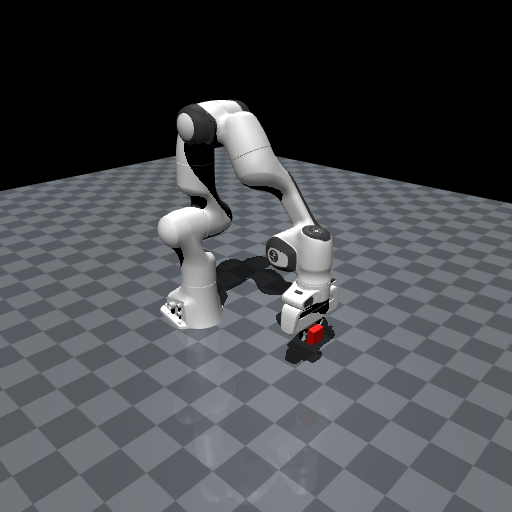
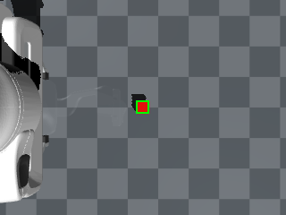

# 第七周：机械臂抓取实践

本周用一个小而完整的任务理解 **感知→规划→控制→评估**。先完成已知位置抓取，再把位置来源换成 RGB-D。程序采用官方 Menagerie Panda 与红色方块，保留教材中“分层组织、先定位、预备→下降→闭合→抬起→评估”的核心目标。

来源是本教材 `sections/9_example_grasp_object.tex`（综合抓取实践）和 `sections/15_vision_grasp_practice.tex`（视觉抓取扩展）。文件数字不直接当作最终章号；当前 `main.tex` 对这两个文件的输入均被注释。机器人、物体、检测器和控制接口的改动见[迁移对照](migration-plan.md)。本课不是教材香蕉程序的逐行兼容移植。

## 1. 先运行已知位置基线

在仓库根目录，安装方法见 README。Windows 用 `py -3.11 run.py` 替换下面的 `python run.py`：

```text
python run.py grasp --release-check
```

程序先让物体在地面上稳定 0.5 s，再通过仿真位置 API 获取物体中心，执行：

1. 夹爪张开，移动到物体中心上方 0.16 m。
2. 下降到中心上方 0.003 m 的抓取位置。
3. 保持关节目标，闭合夹爪 1.5 s。
4. 机械臂抬升 0.12 m。
5. 保持 1 s，记录物体高度、双指接触力、运动速度与相对夹爪位置。
6. 使用 `--release-check` 时打开夹爪，再观察 2 s；物体应自然落地。

先看 `outputs/week07/known/result.json`，再看 `01_initial` 到 `05_lifted` 的图片、RGB-D 数组和 `grasp.gif`。结果不是由画面主观判断：`success` 为真需要物体真的被接触力抬起并保持。



## 2. 跟着代码理解分层

| 层 | 文件 | 输入→输出 | 能读取什么 |
| --- | --- | --- | --- |
| 目标位置 | `grasp.py` / `perception.py` | 真值或 RGB-D→世界 xyz | 基线读取物体真值；vision 定位函数只读图像与标定 |
| 轨迹规划 | `planner.py` | 起点/终点/速度/dt→笛卡尔位置序列 | 不读取物理引擎、相机、关节 |
| 运动控制 | `controller.py` | 位置序列与固定朝向→7 个关节目标＋夹爪命令 | 读取机器人状态与雅可比 |
| 动力学 | `RobotEnv.step` | 执行器目标→力矩、接触、状态变化 | MuJoCo 物理求解 |
| 任务评估 | `grasp.py.evaluate` | 物体状态与保持期记录→分项指标 | 可读取真值，但不反馈给 vision 定位/控制 |

`LinearPlanner` 按距离与平均速度计算步数：`n = ceil(distance/(speed*dt))`，然后对位置线性插值。本课 `dt=0.02 s`，速度 `0.08 m/s`。它不求逆运动学，也不处理避障；移动点位只在已验证工作区使用。

`CartesianController` 使用 MuJoCo `mj_jacSite` 计算 TCP 的位置/姿态雅可比，通过阻尼最小二乘 `dq = J.T @ solve(J @ J.T + λ² I, error)` 迭代 IK。IK 在独立 `MjData` 中运行，不改变真实仿真的关节或物体位置。关节角受模型限位约束；位置残差或姿态残差超限会报错。

IK 得到关节目标后，`env.step()` 使用原生 Panda 位置 PD 执行器推进物理。物体有 freejoint，未焊接到夹爪，没有 mocap 绑定、重设物体 qpos 或“抓到后随手移动”的代码。存在的 joint equality 仅同步两个手指。教材的 `cartesian_pose` 模式把 IK 藏在框架控制器里；本实现把控制层展开，便于课堂阅读。

## 3. 阅读轨迹与误差

`trajectory.json` 每个控制步记录：阶段、仿真时刻、规划 TCP 目标、实际 TCP、物体世界位置、qpos、ctrl、物体速度和两指接触法向力。`trajectory.npz` 为常用数值数组，适合学生画图；`scene.xml` 是当前机器可调试的场景快照。

规划误差、IK 残差、动力学跟踪误差是不同量。默认运行段末 TCP 误差约 5–6 mm，主要来自有限增益与重力下的动态追踪；不应把微小的理想 RGB-D 定位误差等同于最终抓取精度。

课堂练习：用 `time_s` 作横轴，对比 `tcp_xyz_m` 与 `cube_xyz_m` 的 z 曲线；标出下降、闭合、抬升和释放时刻。解释为什么闭合之后才能抬升、为什么打开夹爪后物体轨迹不再跟随 TCP。

## 4. 用 RGB-D 替换目标来源

```text
python run.py vision-grasp --release-check
python run.py vision-grasp --cube-x 0.43 --cube-y 0.025 --output outputs/week07/vision_shifted
```

第二个命令移动方块，检查程序确实从图像重定位。真值只用于保存定位误差，不送入 vision 的 planner。传给 `locate_red_cube` 的只有 RGB、米制深度与标定矩阵。

算法相机位于 [0.45,0,0.85]，垂直向下，320×240，垂直 FOV=45°。流程如下：

1. RGB 中用红色阈值选取像素，至少需要 9 个有效点；没有目标时明确报错。
2. 同一像素读取 `depth_m`，过滤无效值。
3. 用 K 反投影：`p_camera = inv(K) @ [u,v,1] * depth_m`。
4. 用 `T_world_camera_cv` 变换到世界坐标。
5. 对掩码内三维点取中位数，得到可见顶面位置；减去已知半高 0.02 m，估计方块中心。
6. 把中心 xyz 交给与基线相同的规划器和控制器。



标定保存于 `calibration.json`；掩码边框、像素数、表面位置、半高先验与中心误差在 `localization.json`。`detection.png` 的绿色框只标示颜色掩码包围盒。

本 detector 是**受控颜色分割**，不是 YOLO，也没有训练权重或语义类别理解。假设目标是唯一红色、平放、未遮挡且高度已知的方块；俯视可见顶面。任意物体、多个红块、倾倒方块、侧视相机、深度噪声和遮挡需要新的检测/几何估计。理想仿真下数微米到毫米级的数值误差不代表真实相机精度。

深度单位必须保持为米。这里不再做教材 ManiSkill 观测中的 `mm / 1000`。MuJoCo 相机坐标（右、上、后）与 OpenCV（右、下、前）用 `diag(1,-1,-1)` 转换；将轴或外参方向搞反，即使框选正确也会抓错位置。内参使用整数像素中心，主点 `((width-1)/2, (height-1)/2)`。

## 5. 成功判据与负对照

`evaluate` 分开报告 `is_grasped`、`is_lifted`、`stable_hold` 和 `success`：

| 指标 | 判据 |
| --- | --- |
| `is_grasped` | 两个手指同时与方块接触，每指法向力 >0.01 N |
| `is_lifted` | 最终中心高度比初始增加至少 0.06 m |
| `stable_hold` | 保持至少 50 个控制步（1 s）；≥90% 步保持双指接触且≥90% 步抬升≥0.06 m；最高物体速度 <0.02 m/s；相对 TCP 位置最大偏离均值 <0.005 m |
| `success` | 最终抓住且抬起，并通过保持期稳定检查 |

这是一套可检查的课堂判据，适用于当前几何与任务，并非通用抓取质量证明。日志保留最低抬升、速度、相对位置与接触比例，便于审查成功是否可信。

```text
python run.py grasp --keep-open
python run.py grasp --release-check
python run.py test
```

`--keep-open` 全程张开夹爪，预期 `success=false`；此命令将“按预期失败”视为负对照通过，退出码为 0。常规抓取失败则返回非零。释放检查要求方块下降至少 5 cm，且释放后不能被评估为抓取成功。自动测试也检查自由关节、无物体绑定、短暂抬升不能误判稳定保持。

## 6. 课堂任务与提交

- 基础：运行 known，提交 `result.json`、初始/闭合/抬升图和一张 TCP/物体 z 曲线；说明 planner 与 controller 各自负责什么。
- 视觉：移动到 [0.43,0.025]，提交定位图、标定、误差和抓取结果；解释“表面点→物体中心”的半高补偿。
- 对照：保持夹爪张开，再运行释放检查，解释两者为何不同。
- 修改：在小范围内调整线性轨迹速度或抓取高度，每次仅改变一项，记录跟踪误差、接触与成功率。偏离示例工作区应检查碰撞与 IK，不把失败归因于“模型太慢”。

进阶可换成香蕉模型与语义检测器，但须补充合法网格、碰撞/惯量、可达抓取姿态、类别与权重来源、检测误差与接触稳定性验证。教材 YOLO 香蕉例子在本分支中作为扩展阅读，未交付香蕉/YOLO 运行结果。
